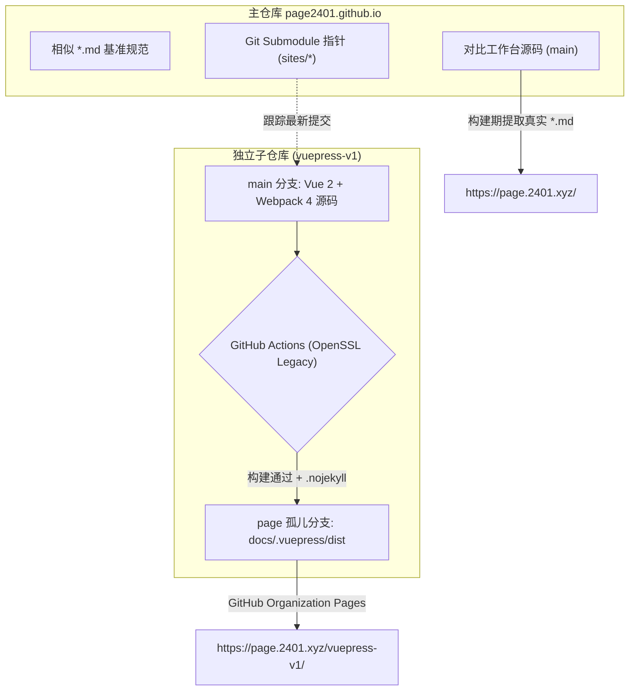
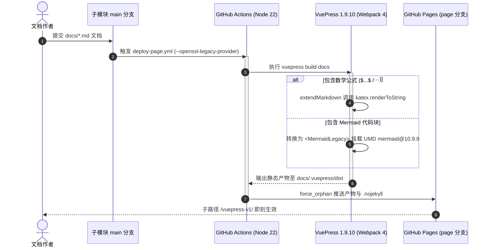
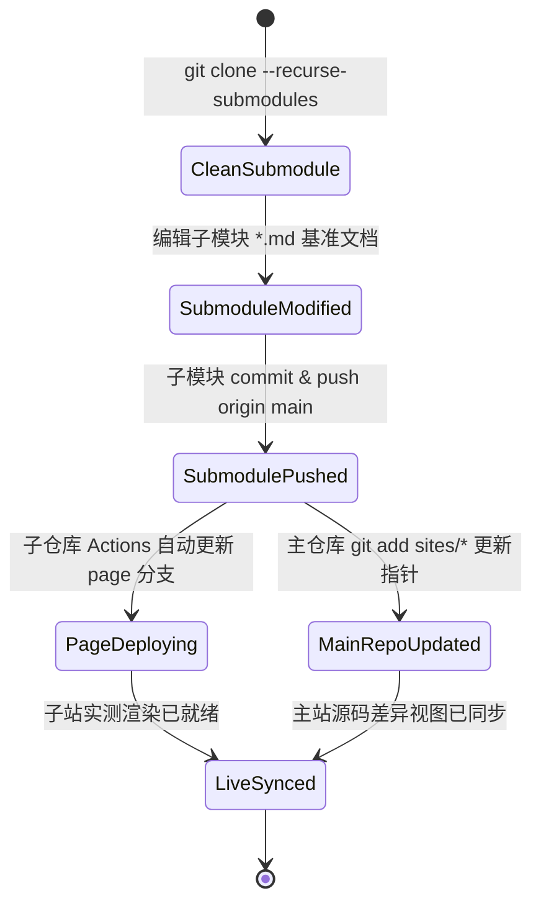

# 02. 流程图与时序图（Mermaid） <Badge text="mermaid@10.9.8 UMD" type="warning" vertical="middle" />

::: warning Webpack 4 时代包袱实录
若在 VuePress v1 组件中直接 `import mermaid from 'mermaid'`（v10/v11/v12），内置的 **Webpack 4 + 旧版 Acorn** 会在解析现代 ES2022 私有字段语法时直接编译崩溃！本子站锁定了最后一代提供预编译单文件 UMD 产物的 `mermaid@10.9.8`，在 `prebuild` 阶段将其复制为静态脚本注入并配合 `.vuepress/components/MermaidLegacy.vue` 渲染。
:::

## 1. 复杂子图与架构流程图（`flowchart TD`）

## 2. 编译管线交互时序图（`sequenceDiagram`）

## 3. 子模块同步状态机（`stateDiagram-v2`）

